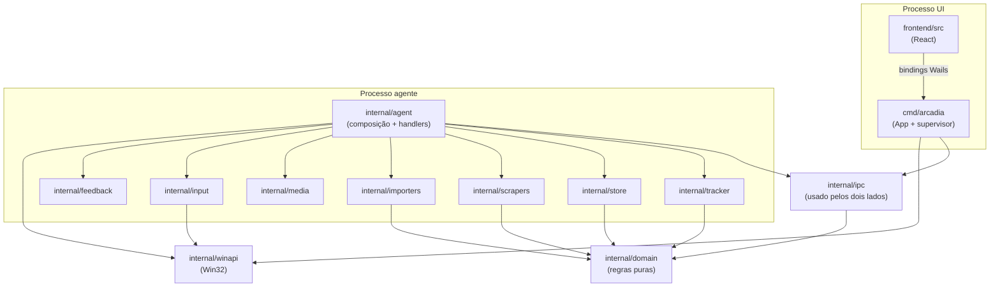
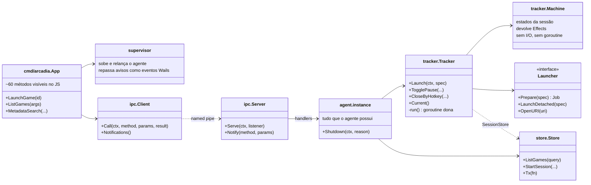
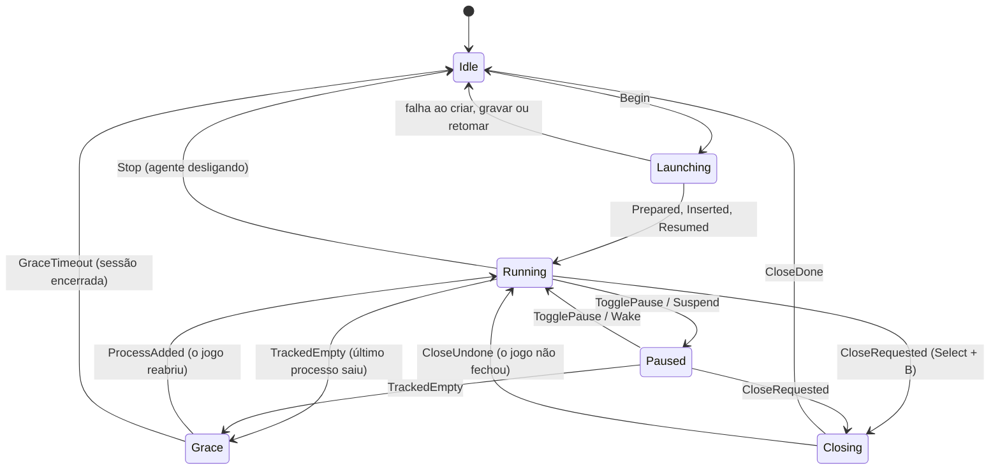
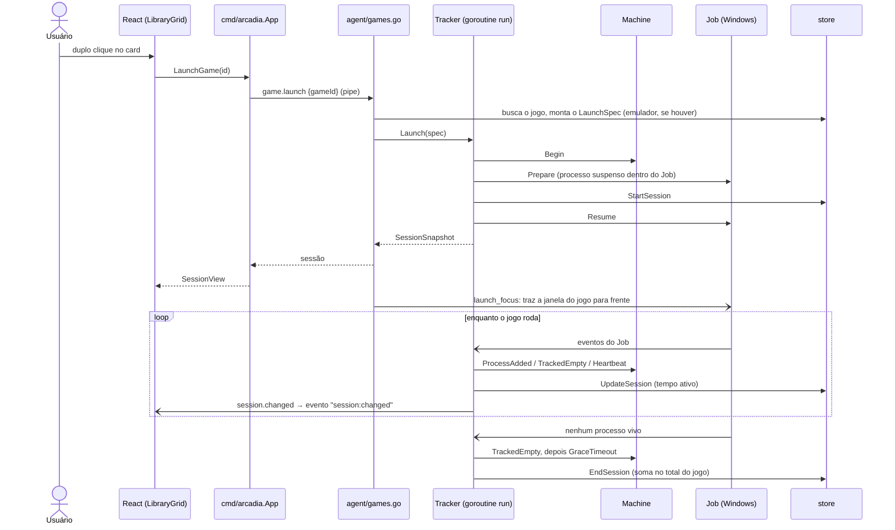
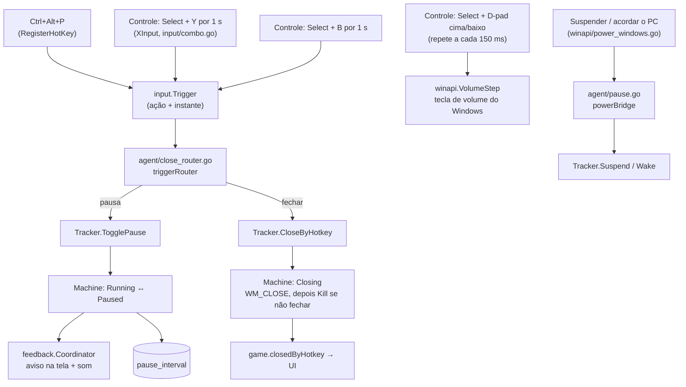
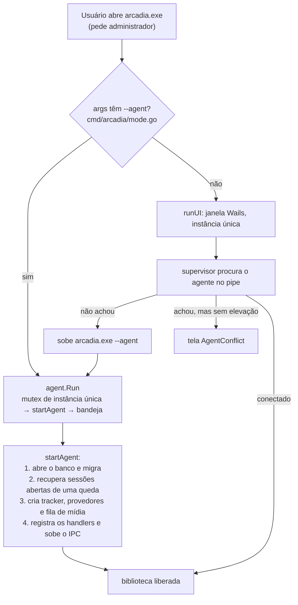
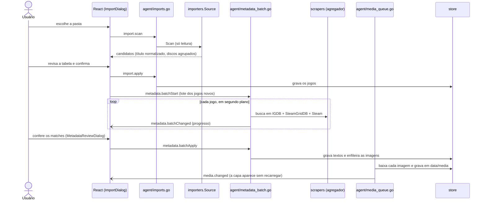
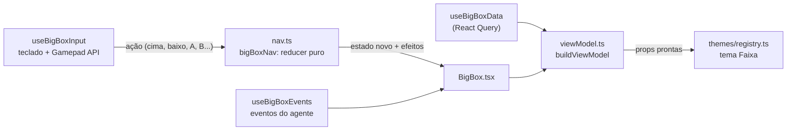
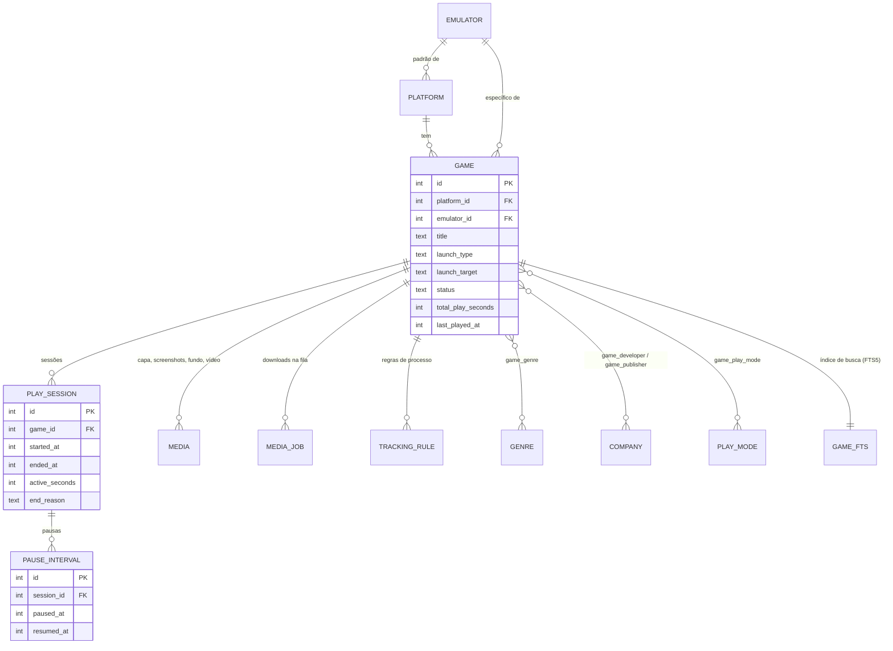

# Guia do projeto Arcadia (versão 1.0.3)

Este guia é para você ler o código do Arcadia sem se perder. Ele parte do que você já sabe (Java, JavaScript, React)
e explica o que muda em Go, onde cada coisa mora e em que ordem ler.

O código é grande: cerca de 110 mil linhas de Go (uns 70% são testes) e 32 mil de TypeScript (dois terços são
testes). Você não precisa ler tudo. O objetivo aqui é mostrar os 20 arquivos que explicam os outros.

Os diagramas são Mermaid: renderizam no GitHub, no VS Code (extensão "Markdown Preview Mermaid Support") e em
[mermaid.live](https://mermaid.live). As decisões formais estão em [adr/](adr/README.md) e o desenho original em
[ARCHITECTURE.md](ARCHITECTURE.md). Este guia não substitui essas fontes.

**Índice**

1. [O Arcadia em um desenho](#1-o-arcadia-em-um-desenho)
2. [Go para quem vem de Java](#2-go-para-quem-vem-de-java)
3. [Estrutura de pastas](#3-estrutura-de-pastas)
4. [As camadas e quem depende de quem](#4-as-camadas-e-quem-depende-de-quem)
5. [As "classes" principais](#5-as-classes-principais)
6. [Fluxos de ponta a ponta](#6-fluxos-de-ponta-a-ponta)
7. [O frontend](#7-o-frontend)
8. [Dados: o banco](#8-dados-o-banco)
9. [Por onde começar a ler](#9-por-onde-começar-a-ler)
10. [Receitas: "quero mudar X, onde mexo?"](#10-receitas-quero-mudar-x-onde-mexo)
11. [Testes e comandos](#11-testes-e-comandos)
12. [Regras do projeto](#12-regras-do-projeto)
13. [Glossário](#13-glossário)

---

## 1. O Arcadia em um desenho

Um launcher de jogos para Windows que conta o tempo de jogo pela **árvore de processos** do jogo, e não pela janela em
foco. Para isso o mesmo `arcadia.exe` roda em dois processos:

```
┌──────────────────────────── arcadia.exe (UI) ─────────────────────────────┐
│                                                                           │
│   React + TypeScript (frontend/src)                                       │
│        │  chama funções JS geradas pelo Wails (window.go.main.App.*)      │
│        ▼                                                                  │
│   cmd/arcadia: struct App  ── "controller" da janela, sem regra de jogo   │
│        │                                                                  │
└────────┼──────────────────────────────────────────────────────────────────┘
         │  JSON-RPC 2.0 por named pipe (pedidos →, respostas e avisos ←)
┌────────▼──────────────── arcadia.exe --agent (bandeja) ───────────────────┐
│                                                                           │
│   internal/ipc      servidor: recebe o método e chama o handler           │
│   internal/agent    handlers + serviços (importar, metadados, mídia...)   │
│   internal/tracker  lança o jogo e conta o tempo  ◄── o coração           │
│   internal/store    SQLite: o ÚNICO lugar que escreve no banco            │
│   internal/input    atalhos de teclado e controle (pausar, fechar)        │
│                                                                           │
└────────┬──────────────────────────────────────────────────────────────────┘
         │  CreateProcess dentro de um Job Object
         ▼
      o jogo (e todos os filhos dele)
```

Três regras saem desse desenho e valem para o código inteiro:

- **A UI nunca influencia o tempo de jogo.** Ela pode fechar ou travar; o agente continua contando.
- **Só o agente escreve no banco** ([ADR 0015](adr/0015-agente-unico-escritor-do-banco.md)). A UI pede tudo por IPC.
- **O agente é quem lança o jogo**, porque só o processo que cria o jogo consegue colocá-lo no Job Object antes de
  ele rodar.

Em termos de Java: a UI é um cliente fino (pense num front que só fala com uma API), e o agente é o backend, com
"controllers" (handlers IPC), "services" (`internal/agent`) e "repositories" (`internal/store`). A diferença é que a
"API" é um pipe local em vez de HTTP.

---

## 2. Go para quem vem de Java

Você vai ler Go mais rápido se trocar alguns reflexos.

| Em Java | Em Go, neste projeto |
|---|---|
| `class Foo { ... }` | `type Foo struct { ... }` com os métodos declarados fora: `func (f *Foo) Bar()` |
| `implements Interface` | Não existe. Um tipo satisfaz a interface se tiver os métodos. Ninguém declara. |
| Interface definida por quem implementa | Interface definida por **quem usa**, pequena, perto do uso. Ex.: `gameStore` em [agent/games.go](../internal/agent/games.go) lista só o que os handlers precisam do banco. |
| `public` / `private` | Letra maiúscula exporta (`Tracker`), minúscula é privado do pacote (`winJob`). |
| Pacote = pasta + arquivos soltos | Pacote = pasta. Todos os arquivos da pasta enxergam os privados uns dos outros. |
| Exceções | Não há. Funções devolvem `(valor, error)` e quem chama testa `if err != nil`. O erro é embrulhado com contexto: `fmt.Errorf("abrir banco: %w", err)`. |
| `try/finally` | `defer`: roda quando a função termina. É assim que handles e locks são liberados. |
| Threads + `ExecutorService` | Goroutines (`go func()`): leves, milhares são normais. |
| `BlockingQueue` | Canal (`chan T`). `select` espera em vários canais ao mesmo tempo. |
| `synchronized` | `sync.Mutex`, ou (preferido aqui) **uma goroutine dona do estado** que recebe pedidos por canal. |
| `CancellationToken` / interrupção | `context.Context`, sempre o primeiro parâmetro. Cancelou o contexto, a operação para. |
| Injeção de dependência (Spring) | Na mão: uma função monta tudo e passa por parâmetro. Aqui é `startAgent` em [agent/app.go](../internal/agent/app.go). |
| Mockito | Fakes escritos à mão que satisfazem a interface pequena. Sem biblioteca de mock. |
| JUnit `@ParameterizedTest` | Testes "table-driven": uma lista de casos e um `for` com `t.Run(nome, ...)`. |
| JPA / Hibernate | SQL escrito à mão em `internal/store/queries/*.sql`; o `sqlc` gera o Go tipado em `store/dbgen`. |
| Flyway | `goose`: arquivos numerados em `internal/store/migrations/`. |
| `Clock` injetável | `domain.Clock`. É proibido chamar `time.Now()` em lógica testável. |

Três idiomas que aparecem em toda parte e confundem no começo:

**1. Arquivos por sistema operacional.** `job_windows.go` só compila no Windows; `job_other.go` é o substituto vazio
para os outros. É o equivalente a ter duas implementações de uma interface e escolher no build. Código Win32 só
aparece em arquivos `*_windows.go`.

**2. A goroutine dona.** Em vez de proteger um objeto com locks, uma goroutine é a única que toca nele, e o resto do
programa manda pedidos por canal e espera a resposta. O `Tracker` é assim:

```
 handler IPC ──► t.launch (canal) ──┐
 atalho      ──► t.ctrl   (canal) ──┼──►  goroutine run():  for { select { ... } }
 Job Object  ──► t.events (canal) ──┤        │
 timers      ──► t.timerC (canal) ──┘        └─► única que lê e altera a Machine
```

Se você conhece o modelo de ator (Akka) ou o event loop do JavaScript, é a mesma ideia.

**3. Tipos privados com construtor público.** `tracker.New(Config{...})` devolve um `*Tracker`. O `Config` é o
lugar das dependências: é ali que os testes trocam o relógio, o banco e o lançador por fakes.

---

## 3. Estrutura de pastas

```
launchbox-improved/
├── cmd/
│   ├── arcadia/            o executável (os dois modos)
│   │   ├── main_windows.go     decide: --agent → agente; senão → janela Wails
│   │   ├── app.go              struct App: o que o React enxerga
│   │   ├── supervisor.go       sobe o agente, reconecta, repassa avisos
│   │   ├── games.go library.go imports.go metadata*.go ...   um arquivo por assunto, só "bindings"
│   │   ├── media_serve.go      serve as imagens e vídeos da pasta data/ para o WebView
│   │   └── wails.json, build/  configuração e ícones do Wails
│   └── fake-game/          jogo falso usado nos testes de rastreamento
│
├── internal/               todo o backend (Go não deixa importar "internal" de fora do módulo)
│   ├── domain/             regras puras: sem banco, sem Windows, sem rede
│   ├── tracker/            lança o jogo e conta o tempo
│   ├── store/              SQLite
│   │   ├── migrations/         00001..00009 (goose)
│   │   ├── queries/            SQL escrito à mão
│   │   └── dbgen/              Go gerado pelo sqlc. NÃO editar.
│   ├── ipc/                protocolo JSON-RPC, cliente, servidor e os tipos de cada método
│   ├── agent/              o processo agente: handlers, serviços, bandeja, desligamento
│   ├── input/              atalho global de teclado e controle (XInput): pausa, fechar e volume
│   ├── feedback/           aviso na tela (fixo durante a pausa) e som ao pausar/retomar
│   ├── scrapers/           IGDB, SteamGridDB, Steam e ScreenScraper
│   ├── importers/          leitura de pastas, Steam, Epic, Xbox, URI e LaunchBox
│   ├── media/              arquivos de imagem e vídeo no disco
│   ├── winapi/             chamadas Win32 isoladas, um arquivo por assunto
│   ├── paths/              onde fica a pasta de dados
│   └── logging/            configuração do slog
│
├── frontend/
│   ├── src/
│   │   ├── main.tsx  App.tsx   entrada e a tela principal (modo desktop)
│   │   ├── components/         os componentes do modo desktop
│   │   ├── bigbox/             o modo console (tela cheia, controle)
│   │   ├── lib/                acesso ao agente, estado e funções puras
│   │   └── assets/             ícones das plataformas
│   └── wailsjs/            gerado pelo Wails: as funções Go vistas do JS. NÃO editar.
│
├── scripts/                geração de ícones e o spec-trace.ps1
└── docs/
    ├── ARCHITECTURE.md  ROADMAP.md
    ├── adr/                38 decisões numeradas
    └── specs/<fase>/       requirements.md, design.md, tasks.md, contracts/
```

Tamanho de cada pacote, para você calibrar o esforço (linhas com os testes):

| Pacote | Linhas | O que tem de grande |
|---|---:|---|
| `internal/agent` | 32 mil | Muitos serviços pequenos; o lote de metadados é o maior |
| `internal/tracker` | 13 mil | Poucos arquivos, lógica densa, muitos testes |
| `internal/store` | 12 mil | Consultas da biblioteca e migrações |
| `internal/ipc` | 12 mil | Quase tudo é definição de tipos (DTOs) |
| `cmd/arcadia` | 11 mil | Bindings repetitivos e o supervisor |
| `internal/scrapers` | 8 mil | Um arquivo por provedor |
| `internal/importers` | 6 mil | Um arquivo por origem |
| `internal/winapi` | 5 mil | Win32 |
| `internal/domain` | 5 mil | Funções puras e curtas |

---

## 4. As camadas e quem depende de quem

As setas apontam para o que o pacote importa. `domain` não importa ninguém; `agent` importa quase todos.



Como ler este desenho:

- **`domain`** é o lugar mais fácil de entrar: funções puras, sem efeitos, com testes curtos.
- **`tracker` não conhece o banco real.** Ele recebe uma interface `SessionStore` e o `agent` entrega o `*store.Store`.
- **`ipc` é compartilhado.** Os tipos de pedido e resposta (`GameListParams`, `GameDetail`...) são os mesmos nos dois
  processos, como um módulo de DTOs compartilhado entre cliente e servidor.
- **`store` e `domain` não importam nada de Windows.**

---

## 5. As "classes" principais

Go não tem classes, mas estas structs fazem o papel. Se você entender estas oito, entende o projeto.



### 5.1 `tracker.Machine` — a máquina de estados (comece por aqui)

Arquivo: [internal/tracker/machine.go](../internal/tracker/machine.go).

É uma classe **pura**: não abre processo, não grava no banco, não tem goroutine nem relógio. Cada método recebe o
instante (`now`) e devolve uma lista de `Effect`, que são ordens para quem a chamou: "grave o início da sessão",
"arme o timer de carência", "avise a UI".

```go
effs := m.TrackedEmpty(now)   // o último processo do jogo saiu
// effs = [EffUpdateSession, EffArmGrace, EffNotify]
```

Esse desenho (decidir separado de executar) é o que permite testar todas as transições sem Windows. Se você conhece
reducers do Redux, é parecido: estado + evento → novo estado + efeitos.



A carência (`Grace`) existe porque muitos jogos abrem por um lançador que fecha e reabre o processo. Sem ela, a
sessão terminaria no meio.

### 5.2 `tracker.Tracker` — o coordenador

Arquivo: [internal/tracker/tracker.go](../internal/tracker/tracker.go) (e [close.go](../internal/tracker/close.go)
para o fechar pelo controle).

É quem **executa** os efeitos que a `Machine` pede. Tem uma goroutine (`run`) com um `select` sobre: pedidos de
lançamento, pedidos de controle (pausa, fechar), eventos do Job Object e timers. Os métodos públicos (`Launch`,
`TogglePause`, `Pause`, `Resume`, `Suspend`, `Wake`, `CloseByHotkey`, `Current`) só mandam um pedido para essa
goroutine e esperam a resposta.

Leia nesta ordem: `Launch` → `run` → `handleLaunch` → `handleJobEvent` → `handleControl`.

### 5.3 `Launcher` e `Job` — a fronteira com o Windows

Arquivos: [launcher.go](../internal/tracker/launcher.go) (as interfaces) e
[job_windows.go](../internal/tracker/job_windows.go) (a implementação real).

O truque central do rastreamento está em `prepareJob`:

```
1. CreateJobObject                 cria o "recipiente"
2. liga o Job a uma completion port (para receber avisos)
3. CreateProcess com CREATE_SUSPENDED   o jogo existe, mas não executou nada
4. AssignProcessToJobObject        entra no recipiente antes de rodar
5. (grava a sessão no banco)
6. ResumeThread                    agora o jogo roda; todo filho nasce dentro do Job
```

Como o processo nasce suspenso, nenhum filho escapa. O Job avisa quando um processo entra, sai e quando não sobra
nenhum (`EventNewProcess`, `EventExitProcess`, `EventActiveZero`).

Há mais dois caminhos, ambos em `tracker`:

- **Lançamento por URI** (jogos da Steam): o shell abre o endereço e não devolve processo. O tracker então "adota" o
  jogo quando acha um processo que casa com as regras ([adopted_job.go](../internal/tracker/adopted_job.go),
  [match.go](../internal/tracker/match.go), [ADR 0025](adr/0025-rastreio-por-processo-adotado.md)).
- **Lançamento sem contar tempo** (`LaunchDetached`): cria o Job só para conseguir fechar o jogo depois, sem sessão.

### 5.4 `store.Store` — o repositório

Arquivo: [internal/store/store.go](../internal/store/store.go), com um arquivo por assunto ao lado
(`sessions.go`, `library.go`, `game_edit.go`, `media.go`, `platforms.go`, `stats.go`...).

- `Open` abre o SQLite e roda as migrações. `Tx(ctx, fn)` roda `fn` em transação.
- O SQL fica em `queries/*.sql`; o `sqlc generate` produz `dbgen/`. Os métodos do `Store` chamam o `dbgen` e
  convertem para os tipos de `domain`.
- A exceção é [library.go](../internal/store/library.go): a listagem da biblioteca monta o SQL à mão, porque o filtro
  (`domain.FilterSpec`), a busca (FTS5) e a ordenação variam.
- Datas são gravadas como milissegundos Unix ([ADR 0009](adr/0009-timestamps-unix-ms.md)); a conversão está em
  `timeconv.go`.

### 5.5 `ipc.Server`, `ipc.Client` e os handlers — a "API"

Arquivos: [protocol.go](../internal/ipc/protocol.go) (nomes dos métodos e códigos de erro),
[dispatch.go](../internal/ipc/dispatch.go), [server.go](../internal/ipc/server.go),
[client.go](../internal/ipc/client.go).

Um handler é só uma função: `func(ctx, params json.RawMessage) (any, error)`. O agente registra todos num mapa
`nome do método → handler`. Compare com um `@RestController`:

| Spring | Arcadia |
|---|---|
| `@PostMapping("/games/launch")` | `ipc.MethodGameLaunch = "game.launch"` no mapa de handlers |
| `@RequestBody LaunchRequest` | `ipc.DecodeParams(params, &p)` |
| `ResponseEntity<SessionDto>` | devolve o valor; o servidor serializa em JSON |
| `throw new NotFoundException()` | `return nil, ipc.NewErrorData(ipc.CodeGameNotFound, ...)` |
| Server-Sent Events | notificações: `session.changed`, `media.changed`, `metadata.batchChanged`, `game.closedByHotkey` |

São cerca de 55 métodos, agrupados por prefixo: `agent.*`, `game.*`, `session.*`, `platform.*`, `emulator.*`,
`library.*`, `import.*`, `provider.*`, `scrape.*`, `media.*`, `metadata.*`, `video.*`, `stats.*`. O contrato escrito
está em `docs/specs/*/contracts/ipc.openrpc.json` (os três métodos da fase 14 ainda não entraram nele).

### 5.6 `agent.instance` e `startAgent` — a "classe de configuração"

Arquivo: [internal/agent/app.go](../internal/agent/app.go).

`startAgent` é o equivalente a uma classe `@Configuration` do Spring escrita à mão: cria o banco, o tracker, os
provedores, a fila de mídia, registra os handlers e sobe o servidor. Se você quer saber "quem cria isto e com quais
dependências", a resposta está nessa função.

`instance.Shutdown` faz o caminho inverso, **em ordem**: fecha o servidor IPC, espera o lote de metadados e a fila de
mídia, fecha o tracker (que grava o fim da sessão), depois o banco e por último o log
([ADR 0013](adr/0013-log-fecha-por-ultimo.md)).

O resto de `internal/agent` são serviços, um arquivo (ou família) por assunto:

| Arquivo | Papel |
|---|---|
| `games.go`, `library.go` | handlers de jogo, sessão e biblioteca |
| `emulator_launch.go`, `emulators.go` | monta a linha de comando do emulador |
| `close_router.go`, `pause.go` | recebe os gatilhos de teclado/controle e de energia e chama o tracker |
| `launch_focus.go` | leva a janela do jogo ao primeiro plano depois de lançar |
| `imports.go`, `import_images.go` | `import.scan` e `import.apply` |
| `scrape.go`, `scrape_providers.go` | busca manual em um provedor e chaves no Credential Manager |
| `metadata.go`, `metadata_batch*.go` | busca unificada e o lote com revisão |
| `media_queue.go`, `video*.go` | fila de download de imagens e vídeos |
| `manual_edit.go` | trocar imagens e tempo jogado na mão |
| `platforms.go`, `stats.go` | plataformas e estatísticas |
| `notifier.go` | manda as notificações para a UI |
| `tray_loop.go`, `tray_windows.go`, `run_windows.go` | bandeja e o `Run`, o "main" do agente |

### 5.7 `cmd/arcadia.App` e o `supervisor` — o lado da janela

Arquivos: [app.go](../cmd/arcadia/app.go) e [supervisor.go](../cmd/arcadia/supervisor.go).

Todo método público de `App` vira uma função JavaScript (`window.go.main.App.LaunchGame`). Quase todos fazem a mesma
coisa: validam o básico, chamam `client.Call("game.launch", ...)` e convertem a resposta para um tipo "View". Não há
regra de negócio aqui.

O `supervisor` é a parte com lógica: procura o agente no pipe, sobe `arcadia.exe --agent` se não houver, reconecta se
cair e transforma as notificações do agente em eventos Wails (`session:changed`, `media:changed`, `metadata:batch`,
`game:closedByHotkey`, `agent:heartbeat`) que o React escuta.

### 5.8 Provedores e importadores — plug-ins por interface

Dois pontos de extensão com o mesmo formato: uma interface pequena e uma implementação por arquivo.

```go
// internal/scrapers/provider.go
type MetadataProvider interface {
    ID() string
    Search(ctx, q Query) ([]Candidate, error)
    Details(ctx, providerID string) (Metadata, error)
    Media(ctx, providerID string) ([]RemoteMedia, error)
}

// internal/importers/types.go
type Source interface {
    ID() string
    Scan(ctx, in ScanInput) (Result, error)   // só lê; quem grava é o agente
}
```

- Provedores: `igdb.go`, `steamgriddb.go`, `steamstore.go`, `screenscraper.go`. O `aggregate.go` consulta vários ao
  mesmo tempo e o `merge.go` junta os resultados ([ADR 0033](adr/0033-busca-unificada-de-metadados-com-agregador-e-confirmacao-em-lote.md)).
- Origens: `folder*.go` (pastas de ROMs, com subpastas e discos agrupados), `file.go`, `steam.go`, `epic.go`,
  `xbox*.go` (jogos instalados pelo app Xbox: lê o registro do Gaming Services e monta a URI `msgamelaunch://`),
  `uri.go` (importar por link) e `launchbox.go`.

---

## 6. Fluxos de ponta a ponta

### 6.1 "Jogar": do duplo clique ao tempo gravado



### 6.2 Pausar e fechar pelo teclado ou controle



O volume do controle não passa pelo tracker: `input/pad.go` chama direto o callback `PadConfig.Volume` (ligado em
`agent/components_windows.go`), com o `repeatDetector` de `input/combo.go` (primeiro passo na hora, repetição após 400 ms).
O aviso "Tempo pausado" fica na tela até a retomada (some 2,5 s depois do "Tempo retomado") ou até a sessão ir para
Grace/terminar (`feedback.EventDismiss`, acionado por `agent/app.go`).

O tempo pausado é guardado como intervalos (`pause_interval`), e o tempo ativo é calculado por
[domain/session_time.go](../internal/domain/session_time.go). Decisão em [ADR 0017](adr/0017-modelo-de-pausa.md).

### 6.3 Inicialização



"Sair" na bandeja fecha os dois processos. Fechar só a janela deixa o agente contando.

### 6.4 Importar jogos e buscar metadados



O lote e a fila são os dois trabalhos longos do agente. Os dois têm goroutines próprias, com dono, e são cancelados e
esperados no desligamento.

### 6.5 Um pedido qualquer, camada por camada

Use isto como modelo mental para qualquer funcionalidade. Exemplo: editar um jogo.

```
GameEditForm.tsx            monta o "patch" só com o que mudou
  └─ lib/library.ts         useUpdateGame → chama o binding e invalida o cache
      └─ wailsjs (gerado)   window.go.main.App.UpdateGame
          └─ cmd/arcadia/library.go    App.UpdateGame → client.Call("game.update")
              ══════════ named pipe ══════════
              └─ ipc/dispatch.go       acha o handler pelo nome
                  └─ agent/library.go  valida (com domain) e chama o store
                      └─ store/game_edit.go   transação: campos, vínculos, índice de busca
```

---

## 7. O frontend

Aqui você está em casa: React 19 com TypeScript, Vite, Tailwind e TanStack Query. Não há Redux nem router.

```
frontend/src/
├── main.tsx          cria o QueryClient e monta <App/>
├── App.tsx           a tela do modo desktop: três colunas e os modais
├── lib/              tudo que não é JSX
│   ├── agent.ts          status da conexão com o agente
│   ├── games.ts          sessão atual, lançar, pausar (hooks + eventos)
│   ├── library.ts        useInfiniteGames, useGame, useUpdateGame... (React Query)
│   ├── filters.ts        FilterSpec e ordenação (espelha o contrato do IPC)
│   ├── selection.ts      reducer do "jogo em foco"
│   ├── gridNav.ts gridLayout.ts   medidas, divisórias e setas da grade (funções puras)
│   ├── imports.ts metadata.ts metadataBatch.ts video.ts manualEdit.ts   um por assunto
│   └── uiPrefs.ts        preferências no localStorage (grade/lista, tema do Big Box)
├── components/       modo desktop
└── bigbox/           modo console
```

### 7.1 A tela do modo desktop

```
┌──────────────────────────────── App.tsx ─────────────────────────────────┐
│ cabeçalho: SearchBox · AgentIndicator · MetadataBatchChip · botões       │
├──────────────┬───────────────────────────────────────┬───────────────────┤
│ Sidebar      │ LibraryToolbar (SortSelect, ViewToggle)│ GameDetailsPanel  │
│  PlatformNav │                                       │   MediaCarousel   │
│  FilterPanel │ LibraryGrid  ou  LibraryList          │   SessionPanel    │
│              │   GameCard → CoverImage               │   SessionsList    │
│              │                                       │ (ou PanelEmpty:   │
│              │                                       │  jogados recentes)│
└──────────────┴───────────────────────────────────────┴───────────────────┘
 modais: ImportDialog · GameEditDialog (GameEditForm, GameImagesEditor) · MetadataDialog
         MetadataReviewDialog · PlatformsDialog · EmulatorsDialog · ProviderKeysDialog · DeleteDialog
 página alternativa: StatsPage
```

Pontos que valem saber antes de mexer:

- **Estado do servidor é React Query.** As chaves ficam em `libraryKeys` ([lib/library.ts](../frontend/src/lib/library.ts)).
  Mutação bem-sucedida invalida as consultas afetadas.
- **Eventos do agente invalidam o cache.** `useSessionEvents`, os eventos de mídia e os do lote escutam os eventos
  Wails e invalidam as chaves certas. É por isso que a tela se atualiza sozinha
  ([ADR 0031](adr/0031-avisos-de-mudanca-em-segundo-plano-como-notificacoes-de-invalidacao.md)).
- **O carrossel dos detalhes** (`MediaCarousel`) mostra capa, screenshots, **vídeo**, título, seleção, fundo e banner,
  nessa ordem (`carouselKindOrder` em `lib/metadata.ts`). O vídeo toca num `<video controls>` e ganha miniatura própria na
  faixa de miniaturas.
- **A grade é virtualizada.** `LibraryGrid` só põe no DOM as linhas visíveis (`@tanstack/react-virtual`). O desenho das
  linhas e das divisórias por ano vem de `gridLayout.ts`, que é função pura e testável.
- **Jogo em foco é um reducer** (`selection.ts`): `empty → loading → shown | error`. Não há página do jogo; os
  detalhes aparecem na coluna da direita ([ADR 0028](adr/0028-biblioteca-em-tres-colunas-sem-pagina-do-jogo.md)).
- **Cores vêm de variáveis CSS** em `index.css`, usadas como classes Tailwind (`bg-raised`, `text-muted`,
  `border-line`) ([ADR 0029](adr/0029-tema-por-variaveis-css.md)).

### 7.2 O modo console (Big Box)

Pasta `frontend/src/bigbox/`. Abre com F11, em tela cheia, e é navegado pelo controle.



O vídeo de fundo e o dos detalhes começam **com som**; se o WebView recusar o autoplay, `playMedia.ts` toca mudo e liga o
som no próximo toque de tecla ou botão. Y liga/desliga o som (`sound` em `nav.ts`).

O mesmo padrão do `Machine` do Go aparece aqui: `nav.ts` é um reducer puro que devolve estado e **efeitos**
(`enterBigBox`, `bringToFront`...), e o componente executa. O tema recebe um "view model" pronto e só desenha; isso
permite trocar de tema sem tocar na lógica ([ADR 0036](adr/0036-big-box-com-temas-selecionaveis.md)).

---

## 8. Dados: o banco

SQLite em `data/library.db`, ao lado do executável (biblioteca portátil, [ADR 0006](adr/0006-biblioteca-portatil.md)).
Imagens e vídeos ficam em `data/media/` e os logs em `data/logs/`. Os caminhos saem de
[internal/paths/paths.go](../internal/paths/paths.go).



O diagrama mostra o essencial. Os nomes exatos das colunas estão nas migrações `00001` a `00009`. Há também
`app_setting` (chave e valor). As chaves dos provedores **não** ficam no banco: vão para o Credential Manager do
Windows.

Para mudar o esquema: crie a migração seguinte, altere o SQL em `queries/`, rode `sqlc generate` e ajuste o método do
`Store`.

---

## 9. Por onde começar a ler

Siga a ordem. Em cada passo, leia só o que está indicado.

**Passo 1 — O modelo (30 min).** Código simples, bom para pegar a sintaxe de Go.

1. [domain/session.go](../internal/domain/session.go): estados e `SessionSnapshot`.
2. [domain/clock.go](../internal/domain/clock.go): a interface `Clock`, o `SystemClock` e o `FakeClock` dos testes.
3. [domain/session_time.go](../internal/domain/session_time.go) e o teste ao lado: como o tempo ativo é calculado.

**Passo 2 — O coração (2 h).** É a parte mais difícil e a mais importante.

4. [tracker/machine.go](../internal/tracker/machine.go): a lista de `EffectKind` e os métodos `Begin`, `Prepared`,
   `TrackedEmpty`, `GraceTimeout`, `TogglePause`.
5. `tracker/machine_test.go`: os testes são a melhor documentação das transições.
6. [tracker/launcher.go](../internal/tracker/launcher.go): só as interfaces.
7. [tracker/tracker.go](../internal/tracker/tracker.go): `Config`, `Launch`, `run`, `handleLaunch`.
8. [tracker/job_windows.go](../internal/tracker/job_windows.go): `prepareJob`.

**Passo 3 — Como um pedido chega (1 h).**

9. [ipc/protocol.go](../internal/ipc/protocol.go): nomes dos métodos e códigos de erro.
10. [ipc/dispatch.go](../internal/ipc/dispatch.go): `Dispatch`.
11. [agent/games.go](../internal/agent/games.go): `gameHandlersWithMedia`, `handleGameLaunch`, `prepareLaunch`.
12. [agent/app.go](../internal/agent/app.go): `startAgent` de cima a baixo, sem entrar nos detalhes.

**Passo 4 — Dados (45 min).**

13. [store/store.go](../internal/store/store.go): `Open` e `Tx`.
14. [store/sessions.go](../internal/store/sessions.go): `StartSession`, `UpdateSession`, `EndSession`.
15. [store/library.go](../internal/store/library.go): `ListGames`.

**Passo 5 — O lado da janela (1 h).**

16. [cmd/arcadia/main_windows.go](../cmd/arcadia/main_windows.go): `run` e `runUI`.
17. [cmd/arcadia/games.go](../cmd/arcadia/games.go): `LaunchGame`, o binding mais simples de seguir.
18. [cmd/arcadia/supervisor.go](../cmd/arcadia/supervisor.go): `run` e `handleNote`.

**Passo 6 — Frontend (1 h).**

19. [frontend/src/App.tsx](../frontend/src/App.tsx): a montagem das três colunas.
20. [frontend/src/lib/library.ts](../frontend/src/lib/library.ts) e [lib/games.ts](../frontend/src/lib/games.ts).
21. [components/LibraryGrid.tsx](../frontend/src/components/LibraryGrid.tsx) com [lib/gridLayout.ts](../frontend/src/lib/gridLayout.ts).

**Depois, só quando precisar:** metadados em lote (`agent/metadata_batch.go`), fila de mídia
(`agent/media_queue.go`), importadores, Big Box e `winapi`.

Uma dica que vale ouro: **cada teste começa pelo ID do requisito** (`t.Run("SES-001/...")`). Achou um comportamento
estranho? Procure o ID no teste, depois o mesmo ID em `docs/specs/`, e você tem o porquê.

---

## 10. Receitas: "quero mudar X, onde mexo?"

| Quero... | Mexo em |
|---|---|
| Um campo novo no jogo | migração nova → `store/queries/*.sql` → `sqlc generate` → `store` → `ipc/library.go` → `agent/library.go` → `cmd/arcadia/library.go` → `lib/library.ts` → componente |
| Um método IPC novo | constante e tipos em `internal/ipc` → handler em `internal/agent` → registro em `startAgent` → binding em `cmd/arcadia` → função em `frontend/src/lib` |
| Um provedor de metadados | arquivo novo em `internal/scrapers` que implemente `MetadataProvider`; registro em `agent/scrape_providers.go` |
| Uma origem de importação | arquivo novo em `internal/importers` que implemente `Source` |
| Mudar como o tempo é contado | `tracker/machine.go` (decisão) e `domain/session_time.go` (cálculo). Só com spec. |
| Um atalho novo | `internal/input` (detecção) e `agent/close_router.go` (o que fazer); atalho que não passa pelo tracker, como o volume, vira um callback em `PadConfig` |
| Algo visual no modo desktop | `frontend/src/components`; cores em `index.css` |
| Algo no Big Box | `bigbox/nav.ts` (navegação), `viewModel.ts` (dados), `themes/faixa` (desenho) |
| Um ícone de plataforma | `scripts/gen-icons.mjs` |
| Uma chamada Win32 nova | arquivo `*_windows.go` em `internal/winapi`, com handle fechado por `defer` |

Depois de mexer em métodos de `App`, rode `wails dev` ou `wails build` para regerar `frontend/wailsjs`.

---

## 11. Testes e comandos

```bash
go build ./...
go test ./...                       # todo o backend (inclui os testes de Windows)
go test ./internal/tracker -run TestMachine    # um pacote, um teste
go vet ./...
cd frontend && npx vitest run       # frontend
cd cmd/arcadia && wails dev         # UI com recarga automática
go run ./cmd/arcadia --agent --data-dir ./.devdata   # só o agente, com dados separados
cd cmd/arcadia && wails build -ldflags "-X main.version=1.0.3"   # gera build/bin/arcadia.exe
sqlc generate                       # depois de alterar internal/store/queries/*.sql
```

Como os testes são feitos:

- **Go:** table-driven, com fakes escritos à mão. O banco de teste é um SQLite real num `t.TempDir()`. O tempo é o
  `FakeClock`, que o teste avança na mão. Os testes de rastreamento lançam o `cmd/fake-game`, um executável que
  obedece a argumentos (criar filhos, sair depois de N ms).
- **Frontend:** Vitest com Testing Library. Os bindings do Wails são trocados por `vi.fn()` em `window.go.main.App`.
- **Nada depende de rede.** Os provedores são testados com um servidor HTTP local.

---

## 12. Regras do projeto

- **Spec antes do código** ([ADR 0008](adr/0008-spec-driven-development.md)): cada fase tem `requirements.md` com IDs
  (`ÁREA-NNN`), `design.md` e `tasks.md`. `scripts/spec-trace.ps1` confere requisito ↔ tarefa ↔ teste.
- **Tempo só por `domain.Clock`.**
- **Toda goroutine tem dono e condição de saída**, e é esperada no desligamento.
- **Todo handle do Windows é fechado** por `defer`, logo depois do erro checado.
- **Sem CGO.** O SQLite é o `modernc.org/sqlite`, em Go puro.
- **Erros** embrulhados com contexto; sem `panic` fora do `main`; log com `slog`.
- **Idioma:** código e comentários em inglês; docs, specs, ADRs e commits em português.
- **Mudou uma decisão de arquitetura?** ADR novo; o antigo é marcado como substituído.

Sobre os agentes do Claude em `.claude/agents/`: o fluxo padrão é spec-writer → planner → test-writer → implementer
(ou tracker-specialist, o único que escreve em `internal/tracker`) → reviewer. Quem escreve o código não escreve o
teste dele.

---

## 13. Glossário

| Termo | Significado |
|---|---|
| **Agente** | O processo `arcadia.exe --agent`, na bandeja. Dono do banco e do rastreamento. |
| **UI** | A janela Wails. Só lê e pede ações ao agente. |
| **Binding** | Método Go de `App` que o Wails expõe ao JavaScript. |
| **Named pipe** | Canal local entre processos do Windows; aqui carrega JSON-RPC 2.0. |
| **Notificação** | Mensagem do agente para a UI sem pedido antes (`session.changed`...). |
| **Sessão** | Uma execução contada de um jogo, do início ao fim. |
| **Job Object** | Recipiente do Windows que agrupa o jogo e os filhos dele. |
| **Completion port (IOCP)** | Fila por onde o Job avisa que um processo entrou ou saiu. |
| **Carência (grace)** | Espera depois que o Job esvazia, para não encerrar a sessão quando um lançador reabre o jogo. |
| **Breakaway** | Filho que sai do Job e deixa de ser rastreado ([ADR 0016](adr/0016-job-do-jogo-permite-breakaway.md)). |
| **Adoção** | Rastrear um processo que o agente não criou (jogos por URI), achado por regra ([ADR 0025](adr/0025-rastreio-por-processo-adotado.md)). |
| **Lançamento sem contar tempo** | Abre o jogo sem sessão ([ADR 0019](adr/0019-lancamento-sem-rastrear.md)). |
| **Effect** | Ordem devolvida pela `Machine` para o `Tracker` executar. |
| **FilterSpec** | O filtro da biblioteca, serializável ([ADR 0020](adr/0020-indice-de-busca-e-filterspec.md)). |
| **FTS5** | Índice de busca textual do SQLite. |
| **Lote de metadados** | Busca em segundo plano para vários jogos, com revisão antes de gravar. |
| **Fila de mídia** | Downloads de imagens e vídeos, um job por arquivo. |
| **Big Box** | O modo console: tela cheia, navegação por controle. |
| **Goroutine** | Linha de execução leve do Go. |
| **sqlc / goose** | Gerador de código a partir de SQL / ferramenta de migrações. |
